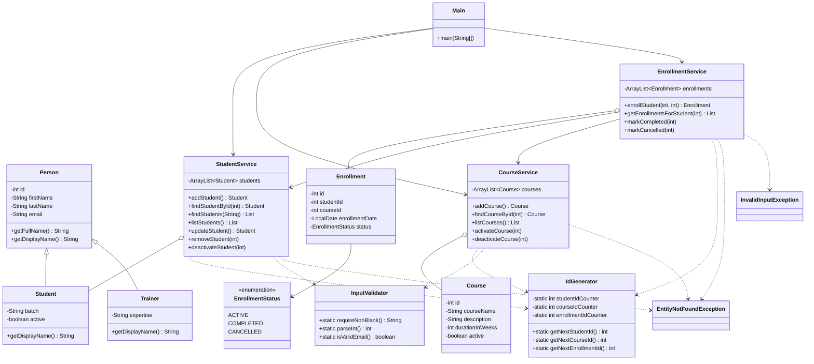

# LearnTrack

LearnTrack is a console-based Student & Course Management System built with Core Java. An admin can manage **students**, **courses** and **enrollments** through a menu-driven interface. All data is kept in memory (`ArrayList`), so it resets when the program exits.

The project practises: classes and objects, constructors (including overloading), encapsulation, inheritance and overriding, static members, `ArrayList`, basic exception handling and a clean separation between entity, service and UI code.

## Features

- **Students:** add (with or without email), view all, search by ID, deactivate (soft delete)
- **Courses:** add, view all, activate / deactivate
- **Enrollments:** enroll a student in a course, view a student's enrollments, mark completed / cancelled
- Invalid input (bad menu option, non-numeric text, unknown IDs, duplicate enrollment) shows a clear message instead of crashing

## Project Structure

```
LearnTrack/
├── README.md
├── docs/
│   ├── Setup_Instructions.md
│   ├── JVM_Basics.md
│   └── Design_Notes.md
└── src/com/airtribe/learntrack/
    ├── entity/      Person, Student, Trainer, Course, Enrollment, EnrollmentStatus
    ├── service/     StudentService, CourseService, EnrollmentService
    ├── ui/          Main
    ├── exception/   EntityNotFoundException, InvalidInputException
    └── util/        IdGenerator, InputValidator
```

## How to Compile and Run

Requires JDK 17 or newer (developed with JDK 21).

From the project root:

```bash
# compile
mkdir -p out
javac -d out $(find src -name "*.java")

# run
java -cp out com.airtribe.learntrack.ui.Main
```

On Windows (PowerShell):

```powershell
mkdir out
javac -d out (Get-ChildItem -Recurse src -Filter *.java).FullName
java -cp out com.airtribe.learntrack.ui.Main
```

You can also open the folder in an IDE (IntelliJ / Eclipse / VS Code), mark `src` as the source root and run `Main`.

## Sample Session

```
===== LearnTrack =====
1. Student Management
2. Course Management
3. Enrollment Management
0. Exit
Choose an option: 3
...
Student ID: 1
Course ID: 1
Enrolled: Enrollment{id=1, studentId=1, courseId=1, date=2026-10-11, status=ACTIVE}
```

## Class Diagram



Enrollment refers to a student and a course by ID (`studentId`, `courseId`), not by object reference.

## Documentation

- [Setup Instructions](docs/Setup_Instructions.md)
- [JVM Basics](docs/JVM_Basics.md)
- [Design Notes](docs/Design_Notes.md)
